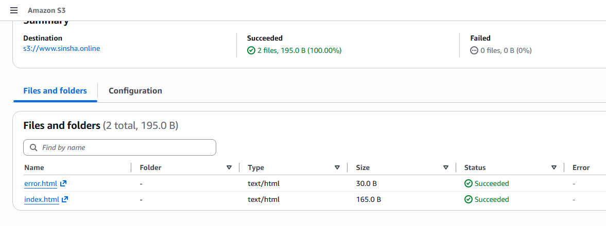
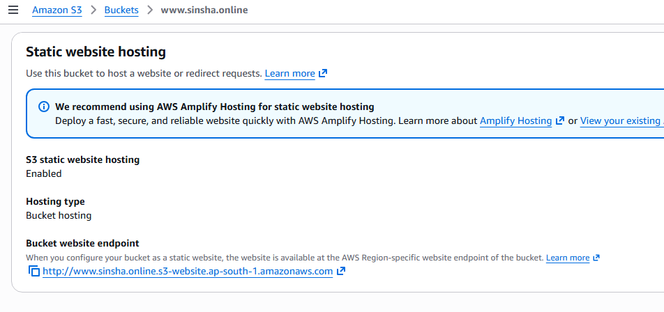
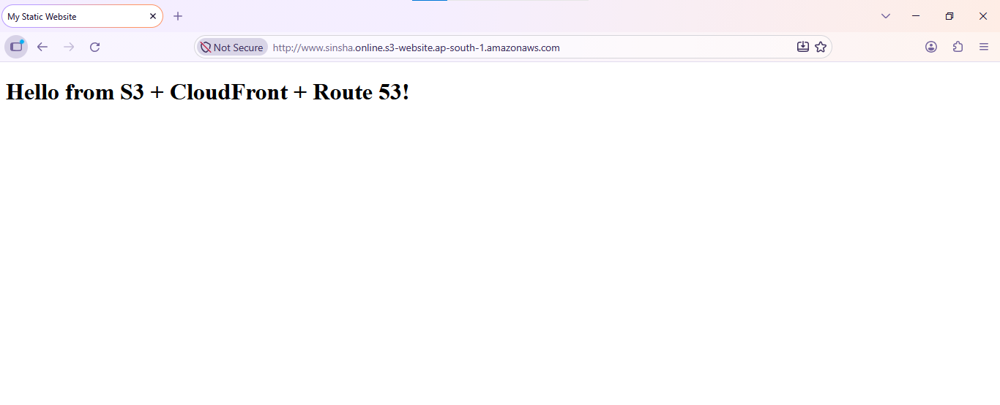
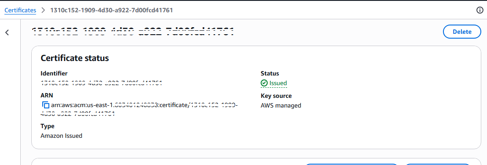
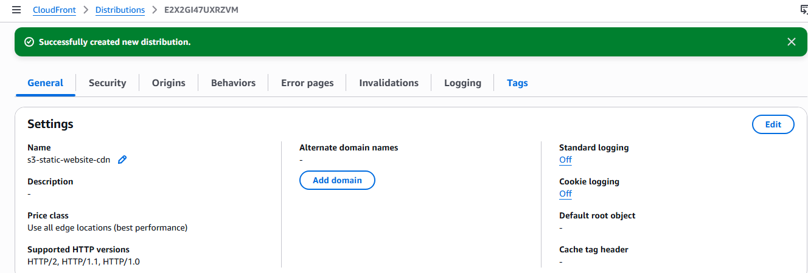
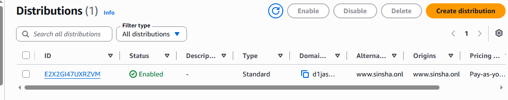
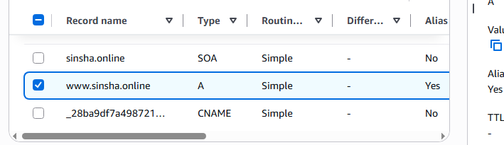
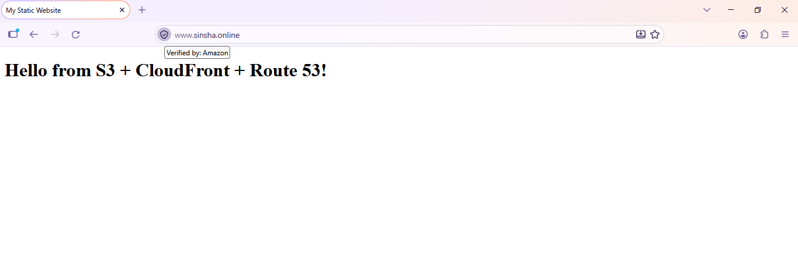
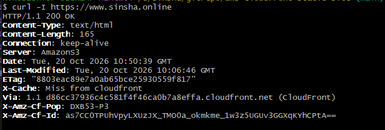

# Static Website on S3 with CloudFront CDN, Route 53 Custom Domain and HTTPS

Host a static website in **Amazon S3**, deliver it globally through **Amazon CloudFront** (AWS's CDN), map it to a **custom domain with Route 53**, and secure it with **HTTPS using AWS Certificate Manager (ACM)**.

---

## Table of Contents

1. [Project Overview](#project-overview)
2. [Architecture](#architecture)
3. [Why This Setup?](#why-this-setup)
4. [Prerequisites](#prerequisites)
5. [Step 1 – Create the S3 Bucket and Upload the Website](#step-1--create-the-s3-bucket-and-upload-the-website)
6. [Step 2 – Enable Static Website Hosting](#step-2--enable-static-website-hosting)
7. [Step 3 – Make the Bucket Content Publicly Readable](#step-3--make-the-bucket-content-publicly-readable)
8. [Step 4 – Request an SSL/TLS Certificate in ACM](#step-4--request-an-ssltls-certificate-in-acm)
9. [Step 5 – Create the CloudFront Distribution](#step-5--create-the-cloudfront-distribution)
10. [Step 6 – Create the Route 53 Record](#step-6--create-the-route-53-record)
11. [Step 7 – Test the Website](#step-7--test-the-website)
12. [Troubleshooting](#troubleshooting)
13. [Cleanup](#cleanup)
14. [Key Learnings](#key-learnings)

---

## Project Overview

| Item | Details |
|------|---------|
| **Goal** | Serve a static website securely and fast using S3 + CloudFront + Route 53 |
| **Services used** | Amazon S3, Amazon CloudFront, Amazon Route 53, AWS Certificate Manager (ACM) |
| **Result** | Website reachable at `https://www.example.com` with a valid certificate |

**What this project covers**

- Integrating infrastructure with Amazon CloudFront
- Hosting a static website in S3
- Integrating the site with Route 53 so anyone can open it using a domain name
- Connecting the CDN to the S3 static website and serving it over HTTPS

> Replace `example.com` and `www.example.com` throughout this guide with your own domain name.

---

## Architecture

```
                      +-------------------+
   User (Browser) --> |     Route 53      |   DNS: www.example.com -> CloudFront (Alias A record)
                      +-------------------+
                                |
                                v
                      +-------------------+
                      |    CloudFront     |   HTTPS (ACM certificate, us-east-1)
                      |   (CDN / Edge)    |   Redirect HTTP -> HTTPS, caching
                      +-------------------+
                                |
                                v   (HTTP, origin = S3 website endpoint)
                      +-------------------+
                      |   S3 Bucket       |   Static website hosting
                      |  (index.html ...) |
                      +-------------------+
```

---

## Why This Setup?

An S3 static website endpoint **only supports HTTP**. It cannot serve HTTPS on its own, and it cannot use your custom SSL certificate.

The solution is to place **CloudFront in front of S3**:

| Problem | How CloudFront solves it |
|---------|--------------------------|
| S3 website endpoint has no HTTPS | CloudFront terminates HTTPS using an ACM certificate |
| Slow for users far from the bucket region | Content is cached at edge locations worldwide |
| Long, ugly S3 URL | Route 53 maps your own domain name to CloudFront |
| Direct traffic hits S3 every time | Cached content reduces S3 requests and cost |

---

## Prerequisites

- An AWS account with permissions for S3, CloudFront, Route 53 and ACM
- A registered domain name (registered in Route 53 or at another registrar)
- A Route 53 **public hosted zone** for the domain
- Website files (at least `index.html`, optionally `error.html`)

**Sample `index.html`**

```html
<!DOCTYPE html>
<html>
  <head>
    <title>My Static Website</title>
  </head>
  <body>
    <h1>Hello from S3 + CloudFront + Route 53!</h1>
  </body>
</html>
```

---

## Step 1 – Create the S3 Bucket and Upload the Website

1. Open the **S3 Console** and click **Create bucket**.
2. Enter a bucket name, for example `www.example.com`.
3. Choose a region (for example `ap-south-1`).
4. Under **Block Public Access settings**, **uncheck** *Block all public access* and acknowledge the warning (required for the website endpoint approach).
5. Click **Create bucket**.
6. Open the bucket → **Upload** → add `index.html` (and `error.html`) → **Upload**.



---

## Step 2 – Enable Static Website Hosting

1. Open the bucket → **Properties** tab.
2. Scroll to **Static website hosting** → **Edit**.
3. Select **Enable**, hosting type **Host a static website**.
4. Index document: `index.html`; Error document: `error.html`.
5. Save changes.
6. Copy the **Bucket website endpoint**, for example:

```
http://www.example.com.s3-website.ap-south-1.amazonaws.com
```



---

## Step 3 – Make the Bucket Content Publicly Readable

Open the bucket → **Permissions** → **Bucket policy** → **Edit**, then add:

```json
{
  "Version": "2012-10-17",
  "Statement": [
    {
      "Sid": "PublicReadGetObject",
      "Effect": "Allow",
      "Principal": "*",
      "Action": "s3:GetObject",
      "Resource": "arn:aws:s3:::www.example.com/*"
    }
  ]
}
```

Test the S3 website endpoint in a browser. You should see the page over **HTTP**.



---

## Step 4 – Request an SSL/TLS Certificate in ACM

> **Important:** CloudFront only uses certificates from the **US East (N. Virginia) – `us-east-1`** region. Switch the region before requesting the certificate.

1. Switch region to **N. Virginia (us-east-1)**.
2. Open **AWS Certificate Manager** → **Request a certificate** → **Request a public certificate**.
3. Add domain names:
   - `example.com`
   - `www.example.com` (or `*.example.com`)
4. Validation method: **DNS validation**.
5. Click **Request**.
6. Open the certificate → click **Create records in Route 53** to add the validation CNAME records automatically.
7. Wait until the status changes to **Issued**.




---

## Step 5 – Create the CloudFront Distribution

The CloudFront console creates a distribution in four wizard steps: **Get started → Specify origin → Enable security → Review and create**. Some settings (HTTPS redirect, custom domain, certificate) are not part of the wizard, so they are configured right after the distribution is created (Part B).

### Part A – Create the distribution (wizard)

1. Open the **CloudFront Console** → **Distributions** → **Create distribution**.
2. **Get started:** enter a **Distribution name**, for example `s3-static-website-cdn`, and continue.
3. **Specify origin:** enter the **S3 website endpoint** (without `http://`) as the origin:

   ```
   www.example.com.s3-website.ap-south-1.amazonaws.com
   ```

   > Use the **website endpoint** from Step 2, not the plain bucket (REST) endpoint from the dropdown. The REST endpoint does not support index document handling for static websites.

   **Domain info (Route 53 managed domain, optional):** the wizard also offers to link a domain that is already registered with Route 53 in your AWS account. If you enter your domain here (for example `www.example.com`), **CloudFront provisions a TLS certificate for you**. If your domain is with a different DNS provider, skip this field and configure the domain later.

   > Two ways to get HTTPS on your domain: let the wizard provision the certificate through this field, **or** use the ACM certificate you requested manually in Step 4. If you use the wizard option, open **General → Settings** after creation (Part B) to confirm the alternate domain name and certificate are attached, and add them manually if they are not.

4. **Enable security:** choose the security (AWS WAF) option you want. For a simple lab you can leave protections off to avoid extra cost; this does not affect the HTTPS setup.
5. **Review and create:** confirm the distribution name and origin, then click **Create distribution**.



### Part B – Configure HTTPS, domain and origin protocol

Open the new distribution and apply these settings.

**1. Origin protocol (Origins tab)**

1. **Origins** tab → select the S3 website origin → **Edit**.
2. Make sure **Protocol** is **HTTP only** (the S3 website endpoint does not support HTTPS).
3. **Save changes**.

**2. Viewer protocol policy (Behaviors tab)**

1. **Behaviors** tab → select the default behavior (path pattern `*`) → **Edit**.
2. **Viewer protocol policy:** **Redirect HTTP to HTTPS**.
3. **Allowed HTTP methods:** GET, HEAD.
4. **Save changes**.

**3. Custom domain, certificate and root object (General tab)**

1. **General** tab → **Settings** → **Edit**.
2. **Alternate domain name (CNAME):** add `www.example.com`.
3. **Custom SSL certificate:** select the ACM certificate issued in Step 4.
4. **Default root object:** `index.html`.
5. **Save changes**.

Wait until the distribution status shows **Deployed**, then copy the **Distribution domain name**, for example `d1234abcd5678.cloudfront.net`.



---

## Step 6 – Create the Route 53 Record

1. Open **Route 53** → **Hosted zones** → select `example.com`.
2. Click **Create record**.
3. Configure:

| Field | Value |
|-------|-------|
| Record name | `www` |
| Record type | `A – Routes traffic to an IPv4 address and some AWS resources` |
| Alias | **Enabled** |
| Route traffic to | **Alias to CloudFront distribution** |
| Distribution | Select your CloudFront distribution |

4. Click **Create records**.



*(Optional)* Create the same alias record for the root domain `example.com` (leave the record name blank) and add `example.com` as an alternate domain name in CloudFront as well.

---

## Step 7 – Test the Website

1. Open `https://www.example.com` in a browser.
2. Confirm the **padlock icon** appears (valid HTTPS certificate).
3. Open `http://www.example.com` and confirm it **redirects to HTTPS**.
4. Optional command line check:

```bash
curl -I https://www.example.com
nslookup www.example.com
```

Expected: `HTTP/2 200` and response headers containing `x-cache` and `via: ... (CloudFront)`.





---

## Troubleshooting

| Issue | Possible cause | Fix |
|-------|---------------|-----|
| `403 Forbidden` from S3 | Bucket policy missing or Block Public Access still on | Re-check Step 1 and Step 3 |
| `404` on `/` | Static website hosting not enabled, or bad index document | Verify Step 2 and CloudFront default root object |
| Certificate not selectable in CloudFront | Certificate requested outside `us-east-1` | Request it again in N. Virginia |
| `ERR_CERT_COMMON_NAME_INVALID` | CNAME not added to CloudFront, or cert does not cover the domain | Add the alternate domain name and use a matching certificate |
| Domain does not resolve | Alias record missing or DNS not propagated | Check Route 53 record and wait a few minutes |
| Old content still showing | CloudFront cache | Create an **invalidation** with path `/*` |
| CloudFront shows `502` | Origin protocol set to HTTPS for S3 website endpoint | Set origin protocol policy to **HTTP only** |

**Invalidate the cache after updating files**

```bash
aws cloudfront create-invalidation \
  --distribution-id <DISTRIBUTION_ID> \
  --paths "/*"
```

---

## Cleanup

To avoid unnecessary charges, remove resources in this order:

1. Delete the Route 53 alias record(s).
2. **Disable**, then **delete**, the CloudFront distribution.
3. Delete the ACM certificate (if no longer needed).
4. Empty and delete the S3 bucket.

---

## Key Learnings

- The S3 website endpoint is **HTTP only**; **CloudFront + ACM** adds HTTPS.
- ACM certificates for CloudFront must be created in **`us-east-1`**.
- Use **Route 53 Alias records** (not CNAME) to point your domain at CloudFront, which also works for the root domain.
- CloudFront caches content at edge locations, improving speed and reducing load on S3.
- After changing website files, **invalidate the CloudFront cache** to see updates immediately.
- **Security note:** this guide uses a public bucket with the website endpoint. For a more locked-down production setup, keep the bucket private, use the S3 REST endpoint as the CloudFront origin with **Origin Access Control (OAC)**, and add a CloudFront Function or Lambda@Edge to handle `index.html` for sub-directories.

---

## Tools and Services

`Amazon S3` · `Amazon CloudFront` · `Amazon Route 53` · `AWS Certificate Manager` · `AWS CLI`